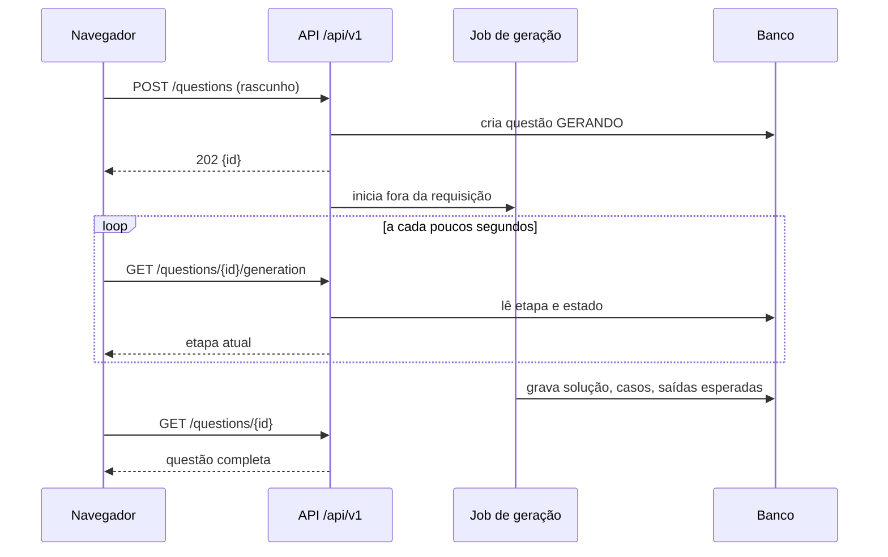
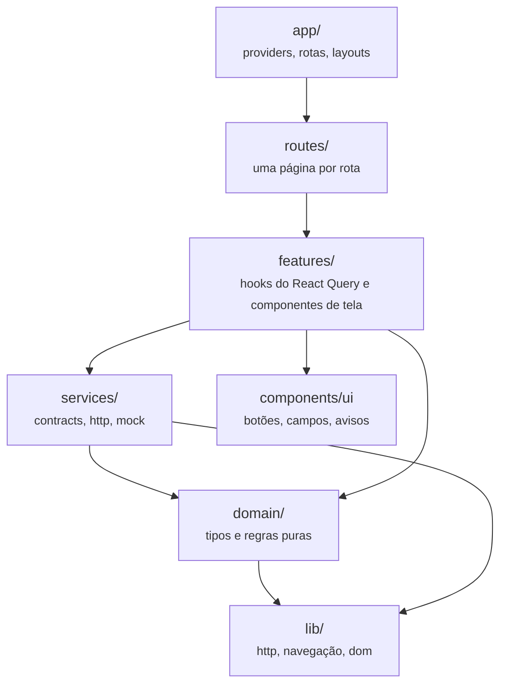

# Integração front-end e backend

Como o front-end em <code>frontend/</code> fala com a API. Geração, biblioteca, revisão, exportação e sessão já têm rota em <code>/api/v1</code>. Esta página descreve o que ainda falta, a forma combinada e a ordem de trabalho.

!!! warning "Parte implementada, parte planejada"
    Implementado as camadas do front-end, o contrato de serviços, o modo simulado, o cliente HTTP com cabeçalho anti-CSRF, `POST /api/v1/questions`, `/generation` e `GET /api/v1/questions/{id}` (#38), a listagem (#41), a retomada (#18), aprovar, rejeitar, gerar de novo, editar o enunciado, a exportação Moodle na resposta, a sessão por cookie, as contas e o dono de cada questão ([ADR-0019](../adr/0019-accounts-sessions-and-question-ownership.md), proposto).
    Planejado os convites de verdade (hoje só o formato é conferido), a verificação de restrições, o resultado de compilação, a suíte de contrato e o modo `http` como padrão (F5). As decisões estão propostas no [ADR-0013](../adr/0013-resource-api-and-cookie-session.md) e no ADR-0019 e ainda dependem de aceite da equipe.

## 1. A lacuna, rota por rota

O front-end chama uma API de recursos sob `/api/v1` (`frontend/src/services/http/endpoints.ts`). O backend expõe essas rotas em `api/routes/resources.py` e `api/routes/session.py`, com sessão, e mantém as chamadas no estilo RPC na raiz, uma por etapa do pipeline (`backend/src/codeexpert/api/routes/questions.py`), ainda sem sessão. Os artefatos de uma geração já podem ficar no Postgres pelo `ArtifactStore` ([ADR-0012](../adr/0012-artifact-store-in-postgres.md)).

| O front chama | O backend de `develop` tem | Falta |
|---|---|---|
| `GET /api/v1/questions` com filtros | o mesmo, paginado, com `q`, `content`, `difficulty`, `status` e também `axis`, `page`, `page_size`, só com as questões do professor e as sem dono ([API](../reference/api.md#get-api-v1-questions)) | paginação na tela; hoje o front pede 100 por página |
| `POST /api/v1/questions` → `202 {id}` | o mesmo, com as cinco etapas numa `BackgroundTask` do FastAPI e o estado do job no banco; após um reinício o job fica `INTERROMPIDO` e `POST /api/v1/questions/{id}/resume` o retoma (G0-8) | nada: a revisão de uma questão interrompida mostra a etapa e o botão **Retomar geração**, que chama `/resume` quando `job.resumable` (G4-3) |
| `GET /api/v1/questions/{id}` | o mesmo, lido dos artefatos, em qualquer estado | verificação de restrições, resultado de compilação, `actual_output`/`passed` (hoje `[]` ou `null`) |
| `GET /api/v1/questions/{id}/generation` | o mesmo: estado, etapas concluídas, motivo da falha em português, e o objeto `job` (estado, etapa, `resumable`) | nada |
| `POST /api/v1/questions/{id}/approve` | o mesmo, sem corpo: quem aprova é o professor da sessão ([API](../reference/api.md#post-api-v1-approve)) | nada |
| `POST /api/v1/questions/{id}/reject`, `/regenerate` | os dois; `/regenerate` cria uma execução nova a partir do mesmo pedido e o front abre o id novo ([API](../reference/api.md#post-api-v1-regenerate)) | nada |
| `PATCH /api/v1/questions/{id}/statement` | o mesmo, só em `GERADA` ([API](../reference/api.md#patch-api-v1-statement)) | nada |
| `POST /api/v1/exports/moodle` com `question_ids` | o mesmo, com o XML na resposta ([API](../reference/api.md#post-api-v1-export)) | nada |
| `GET /api/v1/session`, `POST /api/v1/session`, `POST /api/v1/session/logout` | os três ([API](../reference/api.md#sessao)) | nada |
| `POST /api/v1/accounts` com `invite_code` | o cadastro, conferindo só o formato do convite | convites de verdade: quem emite, validade, uso único |
| `GET /health` | `GET /health` | nada; já bate |

## 2. A forma combinada

O backend ganha uma API de recursos em `/api/v1` que orquestra o pipeline no servidor. O navegador pede "crie uma questão" e consulta o andamento; quem encadeia as cinco etapas é o backend.

A alternativa de o navegador chamar as quatro etapas em sequência foi descartada: ela leva a orquestração para o cliente, deixa o estado de uma geração na memória de uma aba e obriga o front a conhecer a ordem das etapas. Fechar a aba no meio perderia a geração e o custo já pago ao modelo. O [ADR-0013](../adr/0013-resource-api-and-cookie-session.md) registra as alternativas.

As rotas RPC atuais continuam enquanto servirem ao Swagger e aos testes do pipeline. Elas saem quando a API de recursos cobrir o mesmo caso.

As saídas esperadas continuam vindo de compilar e executar a solução no job, nunca do modelo (regra 4 do `AGENTS.md`).

## 3. Camadas do front-end

Implementado As camadas abaixo já existem, e o ESLint (`frontend/eslint.config.js`) recusa import na direção errada.

| Camada | Responsabilidade | Não pode |
|---|---|---|
| `domain/` | tipos do produto (`Question`, `Teacher`, `LoginCredentials`) e regras sem efeito colateral | importar serviço, componente, feature ou React |
| `services/contracts.ts` | interfaces `QuestionsService`, `SessionService`, `SystemService` | conhecer URL ou formato de fio |
| `services/http/` | endpoints, validação da resposta com zod (`dto.ts`), tradução snake_case para o domínio (`mappers.ts`) | importar feature ou componente |
| `services/mock/` | a mesma interface com dados fictícios em memória | entrar no bundle de produção; o carregamento é por `import()` dinâmico |
| `features/` | telas e hooks; falam com o backend só por `useServices()` | importar `app/` ou `routes/`; chamar `fetch` direto |
| `routes/` | monta a página da rota e o título do documento | conter regra de negócio |
| `app/` | providers, roteador e layouts | ser importado por quem está abaixo |
| `components/ui` | peças visuais sem conhecimento do produto | importar domínio, serviço ou feature |
| `lib/` | utilidades genéricas (cliente HTTP, `safeNextPath`) | importar qualquer camada do produto |

O efeito prático: trocar de backend mexe só em `services/http/`. Uma mudança de nome de campo no fio é uma linha em `mappers.ts` e um campo em `dto.ts`; nenhuma tela muda.

## 4. Isolamento

| Mecanismo | Situação |
|---|---|
| A troca entre dados simulados e API real é só `VITE_PUBLIC_API_MODE` (`mock` ou `http`). Build de produção sem a variável usa `http`, para nunca cair em dado falso por acidente | Implementado |
| Toda resposta passa por um schema zod antes de virar tipo do domínio; resposta fora do contrato vira `ResponseShapeError`, não tela quebrada | Implementado |
| O cliente HTTP manda `credentials: 'same-origin'` e o cabeçalho `X-Requested-With: codeexpert-web` em todo método que não é GET | Implementado |
| O ESLint proíbe `localStorage`, `document.cookie`, `dangerouslySetInnerHTML` e import entre camadas na direção errada | Implementado |
| Uma suíte de contrato roda contra o mock e contra o cliente http com MSW, para os dois não divergirem | Planejado |
| O CI compara `/openapi.json` do backend com os DTOs do front e falha se divergirem | Planejado |
| Em produção, front e API no mesmo domínio atrás do proxy da VPS ([ADR-0011](../adr/0011-host-on-a-hostinger-vps.md)); CORS fechado | Planejado |

## 5. Contrato de autenticação

Implementado menos os convites, que são Planejado: hoje o backend aceita qualquer código bem formado ([ADR-0019](../adr/0019-accounts-sessions-and-question-ownership.md)). O backend responde assim:

| Requisição | Resposta |
|---|---|
| `POST /api/v1/session` com `{email, password}` | `204` e cookie de sessão `HttpOnly; Secure; SameSite=Lax; Path=/`. Credencial errada: `401` com a mesma mensagem para e-mail inexistente e senha errada |
| `GET /api/v1/session` | `200 {name, department}` ou `401` |
| `POST /api/v1/session/logout` | `204` e o cookie expirado |
| `POST /api/v1/accounts` com `{name, email, password, invite_code}` | `201` e sessão aberta. Qualquer recusa (convite inválido, já usado, e-mail já cadastrado) devolve a mesma resposta genérica |
| Excesso de tentativas | `429` com `Retry-After` (G8-2) |

Regras que o backend assume, porque o front não pode garantir nenhuma delas:

- **A validação do front é conforto.** O schema em `frontend/src/features/auth/schema.ts` impede o envio de dado malformado e o hook de envio valida de novo antes da chamada, mas qualquer pessoa chama a API sem a página. O backend repete cada regra: formato e tamanho do e-mail, senha de 10 a 128 caracteres fora da lista de senhas comuns, formato do convite.
- **O bloqueio de 30 segundos após 5 falhas no front é só para a tela.** O limite real é por conta e por IP no backend.
- **Nenhum token chega ao JavaScript.** A sessão vive só no cookie; o ESLint já proíbe `document.cookie` e `localStorage`.
- **Todo método que muda estado confere o cabeçalho `X-Requested-With`.** Junto com `SameSite=Lax`, isso fecha o CSRF por formulário de outro site.
- **Mensagem de erro não revela conta nem convite.** O front já troca qualquer detalhe do servidor por uma mensagem genérica; o backend também não deve mandar o detalhe.
- **Senha guardada com hash lento** (`scrypt` da biblioteca padrão, [ADR-0019](../adr/0019-accounts-sessions-and-question-ownership.md)), nunca registrada em log.

Os botões "Entrar com Google" e "Entrar com GitHub" são simulados e não fazem requisição. Entrar por provedor externo exige outra decisão (OAuth, novas origens na CSP, vínculo com convite) e fica fora deste plano.

## 6. Fases

Cada fase vira uma issue própria e só começa quando a anterior está no `main`. F1 a F4 estão Implementado, menos os convites de F1 e a verificação de restrições de F2; F5 está Planejado.

| Fase | Entrega | Depende de | Front-end |
|---|---|---|---|
| F1 Sessão | contas, convites, `/session`, `/accounts`, cookie, limite de tentativas | G8-1, G4-9, G8-2 | guarda de rota `RequireSession` nas rotas do app, redirecionando para `/entrar?proximo=...`; botão de sair |
| F2 Questões guardadas | `GET /questions`, `GET /questions/{id}`, aprovar, rejeitar, editar enunciado | G0-4, G1-5, G3-1, G3-2 | nenhuma mudança de tela; só `dto.ts` se o formato mudar |
| F3 Geração assíncrona | `POST /questions` → `202`, `/generation`, `/regenerate`, estado `INTERROMPIDO` | G0-8 | a tela de acompanhamento já consulta `/generation` |
| F4 Exportação | `POST /exports/moodle` devolvendo o XML na resposta | G1-8 | nenhuma |
| F5 Modo http por padrão | ambiente público com `VITE_PUBLIC_API_MODE=http`, mesmo domínio, CSP revisada | F1 a F4, ADR-0011 | remover a dependência do modo simulado fora de testes e demonstração |

O contrato está em [API](../reference/api.md#api-v1). No modo `http`, as rotas do app (`/biblioteca`, `/gerar`, `/questoes/...`, `/ajuda`) passam pelo guarda `RequireSession`: um `401` em `GET /api/v1/session` leva a `/entrar?proximo=...`.

Ao fim de cada fase, o mesmo teste de ponta a ponta que hoje roda no modo simulado (`frontend/tests/e2e/`) passa a rodar também contra a API real.
