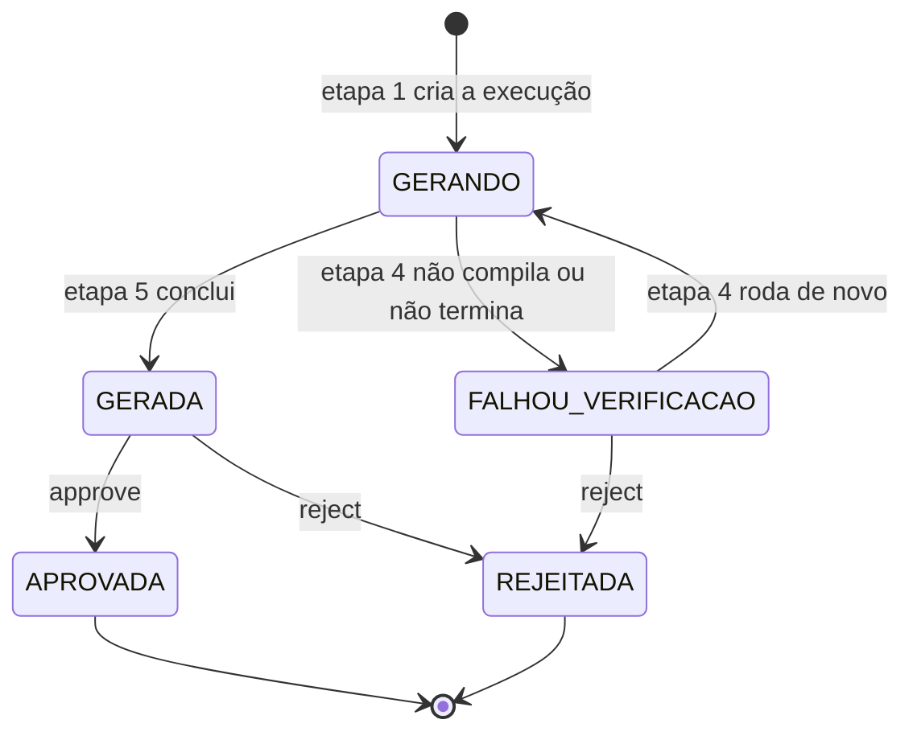

# Ciclo de vida da questão

Toda questão tem um estado explícito, de <code>GERANDO</code> até a decisão de um professor. O que pode ir para o aluno é <code>APROVADA</code>: uma coluna, não uma convenção. Esta é a entrega de G3-1 (#39).

Implementado Os cinco estados, a tabela de transições, a persistência nos dois backends, os endpoints `approve` e `reject`, e o registro de quem aprovou e quando (G3-2, #40).
Planejado Edição antes de aprovar (G3-3) e exportação só do que está aprovado (G3-4) — ver [Roadmap](../product/roadmap.md#revisao-e-aprovacao).

## Estados

| Estado | Significa | Quem leva até ele |
| --- | --- | --- |
| `GERANDO` | A execução foi criada e o pipeline ainda não terminou | Criação da execução (etapa 1), ou nova tentativa da etapa 4 |
| `GERADA` | As cinco etapas terminaram; aguarda revisão | Conclusão da etapa 5 |
| `FALHOU_VERIFICACAO` | A solução não compilou ou não terminou em alguma entrada | Falha da etapa 4 |
| `APROVADA` | Um professor aprovou; pode ir para o aluno | `POST /questions/{run_id}/approve` |
| `REJEITADA` | Um professor descartou | `POST /questions/{run_id}/reject` |

Qualquer outra transição é recusada com `409`. Em particular, **não se aprova o
que falhou na verificação**: a questão precisa voltar a `GERANDO` rodando a etapa 4
de novo e chegar a `GERADA`. `APROVADA` e `REJEITADA` são finais até a G3-3
definir o que significa editar uma questão revisada.

!!! info "Não confundir com o estado do job"
    O plano prevê, na G0-8, um estado `INTERROMPIDO` para o **job** de geração. Ele
    descreve o processo que gera, não a questão, e não faz parte desta tabela.

## Onde a regra mora

A tabela de transições existe em um lugar só: `ALLOWED_TRANSITIONS` em
`backend/src/codeexpert/lifecycle.py`. Todo código muda o estado por
`RunWorkspace.transition()`, que consulta a tabela e levanta
`InvalidTransitionError` (mapeada para `409` em `api/errors.py`) quando a
transição não é permitida.

| Evento | Código | Efeito no estado |
| --- | --- | --- |
| Etapa 1 cria a execução | `RunWorkspace.create()` | `GERANDO` |
| Etapa 4 falha ao compilar ou por tempo | `generate_testcases()` | `GERANDO` → `FALHOU_VERIFICACAO` |
| Etapa 4 roda numa questão que falhou | `generate_testcases()` | `FALHOU_VERIFICACAO` → `GERANDO` |
| Etapa 5 conclui | `RunWorkspace.complete()` | `GERANDO` → `GERADA` |
| Professor aprova | rotas `approve` → `RunWorkspace.approve()` | `GERADA` → `APROVADA` com o registro; já `APROVADA` não muda nada; o resto é `409` |
| Professor rejeita | rota `reject` | conforme a tabela, ou `409` |

Alguns casos não mudam o estado, de propósito:

- **`gcc` ausente** na etapa 4 é falha do servidor, não da questão: o estado fica
  como estava.
- **Concluir a etapa 5 de novo** numa questão já `GERADA`, `APROVADA`,
  `REJEITADA` ou `FALHOU_VERIFICACAO` não muda o estado.
- **A etapa 4 falhar** numa questão já revisada não muda o estado: a falha não
  grava nada, e a questão guardada continua a mesma.

!!! warning "Limitação conhecida"
    Rodar etapas de geração numa questão `APROVADA` ainda sobrescreve os artefatos
    sem desfazer a aprovação. Fechar isso é parte da G3-3.

## Persistência

| Backend | Onde fica | Execuções antigas |
| --- | --- | --- |
| Postgres | coluna `runs.state`, com `CHECK` nos cinco valores | concluídas viram `GERADA` na inicialização; as demais ficam `GERANDO` |
| Local | arquivo `.state` no diretório da execução | sem o arquivo, concluída é `GERADA` e não concluída é `GERANDO` |

O estado fica em `runs`, e não em `questions`, porque a linha de `questions` só
existe depois da etapa 5 ([Modelo de dados](data-model.md)). A escrita é um
*compare-and-set*: `ArtifactStore.set_state(run_id, esperado, novo)` só grava se o
estado ainda é o esperado. Dois professores aprovando e rejeitando ao mesmo tempo
não sobrescrevem um ao outro: o segundo recebe `409`.

## Registro da aprovação

Aprovar grava, junto com o estado, quem aprovou e quando: `reviewed: true`,
`approved_by` (o nome enviado no corpo) e `approved_at` (UTC, do servidor). Ficam
em `meta.json` e, no Postgres, também em `runs.reviewed`, `runs.approved_by` e
`runs.approved_at`. A escrita é o mesmo *compare-and-set* do estado, feita por
`ArtifactStore.record_approval()`: estado e registro nunca discordam.

Aprovar de novo é **idempotente**: responde `200` com o registro da primeira
aprovação e não grava nada, mesmo com outro nome. Se duas aprovações correm ao
mesmo tempo, a que perde também recebe `200` com o registro da que ganhou. A
decisão está no [ADR-0016](../adr/0016-approval-record-on-runs.md).

A decisão e as alternativas do ciclo de vida estão no
[ADR-0015](../adr/0015-question-lifecycle-on-runs.md). O contrato HTTP está em
[API](../reference/api.md#post-questions-run_id-approve).
