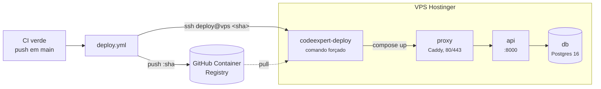

# Deploy

<p class="lead">Como um merge em <code>main</code> chega à VPS da Hostinger, e como preparar essa VPS do zero. Os arquivos estão no repositório; a primeira VPS ainda não foi montada com eles.</p>

<span class="ce-badge ce-status--wip">Em desenvolvimento</span> O workflow, o Compose e os scripts existem ([G0-9](../product/plano-30-11.md#g0-9), [ADR-0011](../adr/0011-host-on-a-hostinger-vps.md)). **Ainda não rodaram numa VPS**: não há URL de produção. Tudo abaixo que depende da máquina está *A confirmar* até a primeira configuração do zero.

!!! danger "A imagem não é um sandbox"
    O serviço compila e roda o código gerado sem isolamento além de tempo, tamanho de saída e dos limites de memória e de processos do container ([ADR-0004](../adr/0004-execution-behind-a-runner-protocol.md)). Por isso o proxy pede usuário e senha em tudo, menos `GET /health`, até existir o acesso por convite ([G8-1](../product/roadmap.md#acesso-e-custo)). Não divulgue a URL nem a senha fora da equipe.

## Como funciona



1. O `ci.yml` termina verde num push em `main`. Falha, cancelamento ou PR não chegam ao deploy ([ADR-0008](../adr/0008-one-gate-for-people-agents-and-ci.md)).
2. O `deploy.yml` confere que o commit ainda é a ponta de `main`; se não for, pula. Deploys nunca são cancelados no meio.
3. Constrói a imagem de `backend/` e envia para `ghcr.io/tutor-ia-makers/codeexpert:<sha>` com o `GITHUB_TOKEN` do próprio job.
4. Entra por SSH como `deploy`. A chave só executa `/usr/local/bin/codeexpert-deploy`, que recebe o SHA e mais nada.
5. Na VPS, o script recusa um SHA que não esteja em `origin/main`, faz checkout dele, baixa a imagem e sobe o Compose. Ele só termina quando a API responde saudável.
6. O job chama `GET /health` pela URL pública e exige que `commit` seja o SHA publicado.

| Arquivo | Papel |
| --- | --- |
| `.github/workflows/deploy.yml` | Os passos acima |
| `deploy/compose.yaml` | `api`, `db` e `proxy`. Só o proxy publica portas. Segredos chegam por `secrets`, nunca por variável de ambiente |
| `deploy/Caddyfile` | TLS automático, autenticação básica em tudo menos `/health`, proxy para `api:8000` |
| `deploy/deploy.sh` | O que a chave de deploy executa. Instalado na VPS como cópia do root |
| `deploy/bootstrap-vps.sh` | Configuração única de uma VPS Ubuntu nova |
| `deploy/production.env.example` | Modelo do `/opt/codeexpert/production.env`: imagem, domínio e usuário/hash da autenticação |

## Na VPS

| O quê | Onde |
| --- | --- |
| Checkout do repositório, no SHA publicado | `/opt/codeexpert/repo` (dono: `deploy`) |
| Configuração não secreta | `/opt/codeexpert/production.env` |
| Chave do LLM | `/etc/codeexpert/secrets/llm_api_key` → `/run/secrets/codeexpert_llm_api_key` (uid 1000, `0400`) |
| URL do banco, com senha | `/etc/codeexpert/secrets/database_url` → `/run/secrets/codeexpert_database_url` (uid 1000, `0400`) |
| Senha do Postgres | `/etc/codeexpert/secrets/postgres_password` (uid 999, `0400`) |
| Dados | Volumes Docker `codeexpert_pgdata`, `codeexpert_var`, `codeexpert_caddy_data` |

Os segredos nunca passam pelo GitHub. A aplicação lê os arquivos de `/run/secrets` ([Segredos em arquivo](../reference/configuration.md#segredos-em-arquivo)), então a chave não aparece em `docker inspect` nem em `/proc/1/environ`.

O esquema do banco é aplicado pela própria API ao iniciar (`store/schema.sql`, idempotente). Migrações versionadas e `pg_dump` diário são do [G1-1](../product/plano-30-11.md#g1-1), <span class="ce-badge ce-status--planned">Planejado</span>: **até lá não há backup do banco.**

## Configuração única {#configuracao-unica}

Feita uma vez por VPS. *A confirmar*: ainda não foi executada do zero.

### 1. A máquina

Na Hostinger, uma VPS KVM com Ubuntu 24.04, pelo menos 2 vCPU e 4 GB de RAM, de preferência num datacenter no Brasil. Entre como root com a sua chave SSH.

No DNS do domínio, crie um registro **A** apontando para o IP da VPS. O Caddy só obtém o certificado depois que o domínio resolver para a máquina.

### 2. A chave de deploy

No seu computador, gere um par só para o GitHub. Ele não serve para mais nada:

```bash
ssh-keygen -t ed25519 -N "" -C deploy@github -f codeexpert-deploy
```

A parte pública (`codeexpert-deploy.pub`) vai para a VPS no passo seguinte. A privada vai para o GitHub no passo 4 e depois é apagada do computador.

### 3. O bootstrap

Na VPS, como root. Leia o script antes de rodá-lo:

```bash
curl -fsSLO https://raw.githubusercontent.com/TUTOR-IA-Makers/tutor-ia/main/deploy/bootstrap-vps.sh
less bootstrap-vps.sh
DEPLOY_PUBLIC_KEY="ssh-ed25519 AAAA... deploy@github" bash bootstrap-vps.sh
```

Ele atualiza o sistema e liga as atualizações automáticas de segurança. Também instala Docker com rotação de logs e abre no firewall só as portas 22, 80 e 443. Por fim, cria o usuário `deploy`, clona o repositório e instala o `codeexpert-deploy`. Pede a chave do LLM sem mostrá-la, gera a senha do Postgres e grava a chave de deploy com o comando forçado. No fim, imprime os valores de `VPS_HOST` e `VPS_HOST_KEY`.

Rodá-lo de novo é seguro: não sobrescreve segredo nem `production.env` existentes, e reinstala o `codeexpert-deploy`. **Mudou `deploy/deploy.sh`? Rode o bootstrap de novo**, porque a VPS só usa a cópia instalada.

Depois, edite `/opt/codeexpert/production.env`. Preencha o `DOMAIN` e o usuário da autenticação, e gere o hash da senha:

```bash
docker run --rm caddy:2.8 caddy hash-password    # digite a senha da equipe
```

Coloque o hash entre **aspas simples**. Ele contém `$`, que o Compose tentaria expandir.

### 4. O GitHub

Em *Settings → Environments → production* (restrito à branch `main`):

| Tipo | Nome | Valor |
| --- | --- | --- |
| Secret | `DEPLOY_SSH_KEY` | Conteúdo de `codeexpert-deploy` (a chave privada) |
| Variable | `VPS_HOST` | IP da VPS |
| Variable | `VPS_HOST_KEY` | A linha `IP ssh-ed25519 AAAA...` impressa pelo bootstrap |
| Variable | `PRODUCTION_URL` | `https://` + o domínio |

Sem qualquer um deles, o job para no primeiro passo e diz qual falta.

### 5. O primeiro deploy

Faça um merge em `main`, ou reexecute o último *Deploy* em *Actions → Deploy → Re-run jobs*. Na primeira vez o pacote `codeexpert` nasce **privado** no GHCR e a VPS não consegue baixá-lo. Torne-o público em *Packages → codeexpert → Package settings → Change visibility*. A imagem não contém segredo ([ADR-0009](../adr/0009-container-image-with-gcc.md)). Depois, reexecute o job.

### 6. Conferir

```bash
curl https://SEU_DOMINIO/health                   # {"status":"ok",...,"commit":"<sha de main>"}
curl -u equipe https://SEU_DOMINIO/config         # api_key_configured: true
```

Na VPS, confira que a chave não está no ambiente do container (demonstração do [G0-3](../product/plano-30-11.md#g0-3)):

```bash
key=$(sudo cat /etc/codeexpert/secrets/llm_api_key)
docker inspect codeexpert-api-1 | grep -cF "$key"                              # 0
docker exec codeexpert-api-1 cat /proc/1/environ | grep -caF "$key"            # 0
unset key
```

O `grep` procura o valor da chave e só imprime quantas linhas o contêm, então a chave não aparece no terminal.

## Operar

| Tarefa | Como |
| --- | --- |
| Voltar para um commit anterior | Como `deploy` na VPS: `codeexpert-deploy <sha>`. Imagens de até 30 dias ficam na máquina |
| Ver logs | `docker logs -f codeexpert-api-1` (e `codeexpert-proxy-1`, `codeexpert-db-1`) |
| Trocar a chave do LLM | Sobrescreva `/etc/codeexpert/secrets/llm_api_key` (mantendo dono 1000 e `0400`) e rode `docker restart codeexpert-api-1` |
| Trocar a chave de deploy | Gere outra (passo 2), troque a linha em `~deploy/.ssh/authorized_keys` e o secret `DEPLOY_SSH_KEY`. Faça isso também quando alguém com acesso de admin ao repositório sair |

!!! warning "O que a VPS custa"
    Somos nós que operamos a máquina: disco, atualizações do Docker, renovação do TLS. Quem tem acesso ao Docker na VPS (inclusive o usuário `deploy`) é root nela e lê os segredos. Uma VPS é um ponto único de falha. A lista completa está nas consequências do [ADR-0011](../adr/0011-host-on-a-hostinger-vps.md#consequences).
