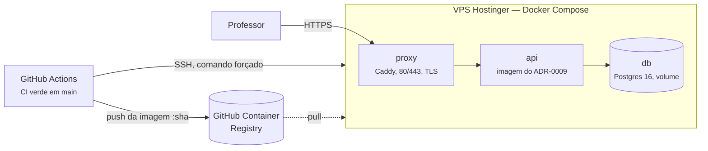

# Deploy

Onde o serviço vai rodar e como um merge em <code>main</code> chega lá. A equipe trocou o Cloud Run por uma VPS da Hostinger; esta página separa o que existe no repositório do que ainda vai ser feito.

Planejado Não há deploy em produção nem URL pública. A hospedagem na Hostinger está proposta no [ADR-0011](../adr/0011-host-on-a-hostinger-vps.md) e o workflow que a usa ainda não existe ([G0-9](../product/plano-30-11.md#g0-9)).

!!! danger "A imagem não é um sandbox"
    O serviço compila e roda o código gerado sem isolamento além de tempo e tamanho de saída ([ADR-0004](../adr/0004-execution-behind-a-runner-protocol.md)). Na VPS, só o proxy publica portas, e a URL não deve ser divulgada antes do acesso por convite ([G8-1](../product/roadmap.md#acesso-e-custo)). As [regras de segurança](https://github.com/TUTOR-IA-Makers/tutor-ia/blob/main/.agents/rules/security.md) pedem que o serviço não fique exposto à internet sem autenticação.

## O que existe hoje

`.github/workflows/deploy.yml` publica no **Cloud Run** ([ADR-0010](../adr/0010-continuous-deployment-after-the-gate.md)). Ele dispara quando o `ci.yml` termina em `main`, mas o projeto GCP nunca foi configurado: sem as variáveis `GCP_*` o job para com erro antes de construir a imagem, e cada merge em `main` deixa uma execução vermelha do *Deploy* no Actions. Esse workflow vai ser substituído, não configurado.

O que dele continua valendo, e o G0-9 mantém:

- O deploy só roda se o CI **passou** num push em `main` (`workflow_run`). Falha, cancelamento ou PR não chegam ao deploy, e o portão não é repetido ([ADR-0008](../adr/0008-one-gate-for-people-agents-and-ci.md)).
- Um deploy nunca é cancelado no meio. Se o commit deixou de ser a ponta de `main` enquanto esperava, ele é pulado.
- A imagem é marcada com o SHA do commit, e `CODEEXPERT_COMMIT_SHA` recebe o mesmo valor.
- No fim, `GET /health` precisa devolver esse SHA em `commit`, ou o job falha.

## Como vai ficar na Hostinger

Resumo do [ADR-0011](../adr/0011-host-on-a-hostinger-vps.md). Nada disto está configurado.

| Peça | Como |
| --- | --- |
| Máquina | Uma VPS KVM com Ubuntu e Docker Compose, ≥ 2 vCPU. Plano e datacenter *A confirmar* |
| Portas | Só o proxy publica, 80 e 443. API e Postgres ficam na rede interna do Compose. Firewall libera 22, 80 e 443 |
| Imagem | GitHub Container Registry, tag = SHA. O job envia com o `GITHUB_TOKEN`; a VPS baixa. Como a imagem não contém segredo, o pacote pode ser público |
| Deploy | O job, no ambiente `production` restrito a `main`, entra por SSH com uma chave cujo `authorized_keys` só permite rodar o script de deploy. A chave do host fica fixada numa variável do repositório |
| Segredos | Chave do LLM e senha do banco ficam só na VPS, como arquivos montados pelo Compose em `/run/secrets`. Nunca passam pelo GitHub ([G0-3](../product/plano-30-11.md#g0-3)) |
| Banco | Postgres no mesmo Compose, migrações aplicadas por um serviço que roda antes da API, `pg_dump` diário copiado para fora da VPS ([G1-1](../product/plano-30-11.md#g1-1)) |
| Estado da geração | Até o [G0-4](../product/plano-30-11.md#g0-4), `var/` num volume Docker. Sobrevive a reinício e a deploy, porque há uma máquina só |

!!! warning "O que a troca custa"
    Somos nós que operamos a máquina: atualizações do sistema e do Docker, disco, renovação do TLS, rotação de logs. Uma VPS é um ponto único de falha, e o backup só vale depois de um restore testado. A lista completa está nas consequências do [ADR-0011](../adr/0011-host-on-a-hostinger-vps.md#consequences).

## Chave do modelo

Sem `CODEEXPERT_LLM_API_KEY` o serviço sobe e responde `GET /health`, mas a geração responde `503` ([configuração](../reference/configuration.md#variaveis-de-ambiente)). Levar a chave à VPS como arquivo é o [G0-3](../product/plano-30-11.md#g0-3), Planejado.
