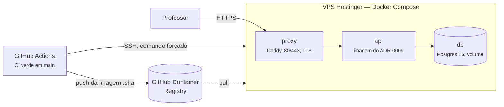

# Deploy

<p class="lead">Onde o serviço vai rodar e como um merge em <code>main</code> chega lá. A equipe trocou o Cloud Run por uma VPS da Hostinger; esta página separa o que existe no repositório do que ainda vai ser feito.</p>

<span class="ce-badge ce-status--planned">Planejado</span> Não há deploy em produção nem URL pública. A hospedagem na Hostinger está proposta no [ADR-0011](../adr/0011-host-on-a-hostinger-vps.md) e o workflow que a usa ainda não existe ([G0-9](../product/plano-30-11.md#g0-9)).

!!! danger "A imagem não é um sandbox"
    O serviço compila e roda o código gerado sem isolamento além de tempo e tamanho de saída ([ADR-0004](../adr/0004-execution-behind-a-runner-protocol.md)). Na VPS, só o proxy publica portas, e a URL não deve ser divulgada antes do acesso por convite ([G8-1](../product/roadmap.md#acesso-e-custo)). As [regras de segurança](https://github.com/TUTOR-IA-Makers/tutor-ia/blob/main/.agents/rules/security.md) pedem que o serviço não fique exposto à internet sem autenticação.

## O que existe hoje

`.github/workflows/deploy.yml` publica no **Cloud Run** ([ADR-0010](../adr/0010-continuous-deployment-after-the-gate.md)). Ele dispara quando o `ci.yml` termina em `main`, mas o projeto GCP nunca foi configurado: sem as variáveis `GCP_*` o job para com erro antes de construir a imagem, e cada merge em `main` deixa uma execução vermelha do *Deploy* no Actions. Esse workflow vai ser substituído, não configurado.

O que dele continua valendo, e o G0-9 mantém:

- O deploy só roda se o CI **passou** num push em `main` (`workflow_run`). Falha, cancelamento ou PR não chegam ao deploy, e o portão não é repetido ([ADR-0008](../adr/0008-one-gate-for-people-agents-and-ci.md)).
- Um deploy nunca é cancelado no meio. Se o commit deixou de ser a ponta de `main` enquanto esperava, ele é pulado.
- A imagem é marcada com o SHA do commit, e `CODEEXPERT_COMMIT_SHA` recebe o mesmo valor.
- No fim, `GET /health` precisa devolver esse SHA em `commit`, ou o job falha.

## Como vai ficar na Hostinger

Resumo do [ADR-0011](../adr/0011-host-on-a-hostinger-vps.md). Nada disto está configurado.



| Peça | Como |
| --- | --- |
| Máquina | Uma VPS KVM com Ubuntu e Docker Compose, ≥ 2 vCPU. Plano e datacenter *A confirmar* |
| Portas | Só o proxy publica, 80 e 443. API e Postgres ficam na rede interna do Compose. Firewall libera 22, 80 e 443 |
| Imagem | GitHub Container Registry, tag = SHA. O job envia com o `GITHUB_TOKEN`; a VPS baixa. Como a imagem não contém segredo, o pacote pode ser público |
| Deploy | O job, no ambiente `production` restrito a `main`, entra por SSH com uma chave cujo `authorized_keys` só permite rodar o script de deploy. A chave do host fica fixada numa variável do repositório |
| Segredos | Chave do LLM e senha do banco ficam só na VPS, como arquivos montados pelo Compose em `/run/secrets`. Nunca passam pelo GitHub ([G0-3](../product/plano-30-11.md#g0-3)) |
| Banco | Postgres no mesmo Compose, migrações aplicadas por um serviço que roda antes da API, `pg_dump` diário copiado para fora da VPS ([G1-1](../product/plano-30-11.md#g1-1)). Os arquivos já estão no repositório: ver [Banco de dados e backup](#banco-de-dados-e-backup) |
| Estado da geração | Até o [G0-4](../product/plano-30-11.md#g0-4), `var/` num volume Docker. Sobrevive a reinício e a deploy, porque há uma máquina só |

!!! warning "O que a troca custa"
    Somos nós que operamos a máquina: atualizações do sistema e do Docker, disco, renovação do TLS, rotação de logs. Uma VPS é um ponto único de falha, e o backup só vale depois de um restore testado. A lista completa está nas consequências do [ADR-0011](../adr/0011-host-on-a-hostinger-vps.md#consequences).

## Chave do modelo

Sem `CODEEXPERT_LLM_API_KEY` o serviço sobe e responde `GET /health`, mas a geração responde `503` ([configuração](../reference/configuration.md#variaveis-de-ambiente)).

<span class="ce-badge ce-status--done">Implementado</span> A aplicação lê a chave de `/run/secrets/codeexpert_llm_api_key` quando a variável não está definida ([Segredos em arquivo](../reference/configuration.md#segredos-em-arquivo)).

<span class="ce-badge ce-status--planned">Planejado</span> O lado da VPS, que depende do Compose do [G0-9](../product/plano-30-11.md#g0-9). Nada disto foi testado numa máquina:

- O arquivo fica num diretório do root com permissão `0700`. O Compose monta o arquivo no container sem copiá-lo, então ele mantém dono e permissões do host. Como o container roda como o usuário `app` (uid `1000`, ver `Dockerfile`), o arquivo pertence ao uid `1000` e tem permissão `0400`. *A confirmar na VPS.*
- No `compose.yaml`, o segredo é declarado com `file:` apontando para esse arquivo e entra no serviço `api` com `target: codeexpert_llm_api_key`. `CODEEXPERT_LLM_API_KEY` não aparece em `environment:` nem num `env_file:`.
- A senha do banco segue o mesmo caminho quando existir o campo dela em `Settings` ([G1-1](../product/plano-30-11.md#g1-1)).
- A demonstração do [G0-3](../product/plano-30-11.md#g0-3) é mostrar que `docker inspect` e `/proc/1/environ` do container não contêm a chave e que uma geração funciona.

## Banco de dados e backup {#banco-de-dados-e-backup}

<span class="ce-badge ce-status--done">Implementado</span> No repositório, testado só numa máquina de desenvolvimento ([ADR-0013](../adr/0013-versioned-migrations-with-alembic.md)):

| Arquivo | O que faz |
| --- | --- |
| `deploy/compose.yaml` | `db` (Postgres 16, volume `pgdata`, só na rede interna `data`, sem porta publicada) → `migrate` (`codeexpert migrate`, roda e sai) → `api` (só sobe se `migrate` terminou com sucesso). Não tem o proxy: ele vem com o [G0-9](../product/plano-30-11.md#g0-9) |
| `deploy/backup.sh` | `pg_dump` em formato custom num diretório da VPS, copiado com `rsync` para fora dela. Falha se a cópia falhar. Apaga cópias locais com mais de 14 dias |
| `deploy/restore-check.sh` | Restaura um dump num banco temporário ao lado do de produção, mostra revisão do esquema e contagens, e apaga o banco temporário. A saída é a evidência de que o restore foi testado |

O Compose lê três arquivos de `CODEEXPERT_SECRETS_DIR`, que fica fora do repositório:

| Arquivo | Conteúdo | Lido por |
| --- | --- | --- |
| `postgres_password` | A senha, sem quebra de linha | `db` (uid `999`) |
| `codeexpert_database_url` | `postgresql://codeexpert:<senha>@db:5432/codeexpert` | `migrate` e `api` (uid `1000`) |
| `codeexpert_llm_api_key` | A chave do provedor | `api` (uid `1000`) |

A senha aparece em dois arquivos. Para trocá-la, mude os dois e a senha do papel `codeexpert` no banco.

Para subir localmente (com Docker):

```bash
CODEEXPERT_SECRETS_DIR=/caminho/para/segredos docker compose -f deploy/compose.yaml up -d --build
docker compose -f deploy/compose.yaml logs migrate     # "Running upgrade  -> 0001"
```

!!! note "Fedora e outras distribuições com SELinux"
    O container não consegue ler os arquivos de segredo (`Permission denied` no log do `db`) até eles receberem o rótulo certo: `chcon -R -t container_file_t /caminho/para/segredos`. O Ubuntu da VPS não usa SELinux.

<span class="ce-badge ce-status--planned">Planejado</span> Depende da VPS do [G0-9](../product/plano-30-11.md#g0-9):

- O job de deploy rodar `docker compose -f deploy/compose.yaml up -d` com `CODEEXPERT_IMAGE` apontando para a imagem do commit.
- A entrada do cron que roda `deploy/backup.sh` todo dia, e o destino fora da VPS (`CODEEXPERT_BACKUP_REMOTE`). *A confirmar.*
- O primeiro restore registrado com `deploy/restore-check.sh`, e a demonstração de que a 5432 não responde de fora da VPS.
- Dono e permissão dos arquivos de segredo na VPS. *A confirmar.*

### Restaurar depois de uma perda

<span class="ce-badge ce-status--planned">Planejado</span> Nunca executado. Procedimento esperado, a validar no primeiro restore real:

```bash
docker compose -f deploy/compose.yaml stop api
docker compose -f deploy/compose.yaml exec -T db dropdb -U codeexpert --force codeexpert
docker compose -f deploy/compose.yaml exec -T db createdb -U codeexpert codeexpert
docker compose -f deploy/compose.yaml exec -T db pg_restore -U codeexpert -d codeexpert --no-owner --exit-on-error < codeexpert-AAAAMMDDTHHMMSSZ.dump
docker compose -f deploy/compose.yaml up -d            # migrate leva o dump até a última revisão
```
